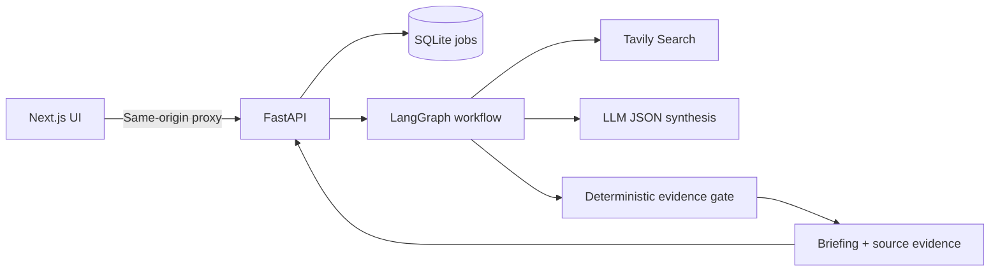

# MeetingIntel AI

MeetingIntel is a local research assistant for preparing for a meeting. Enter a company or person, the meeting time, and your goal to generate a short briefing with recent developments, citations, and questions to ask.

- **Research around your meeting.** Tavily finds official pages and news, and a language model produces structured findings based on the material retrieved.
- **Inspect the evidence.** Open a citation to see the excerpt, its date evidence, and the original publication. Findings with unconfirmed timing appear in a separate section.
- **Take the briefing with you.** Copy it, download Markdown, or print a compact PDF from the browser.
- **Try the workflow locally.** The fictional demo runs without API keys. Automated checks cover the demo and simulated provider responses. Live research requires Tavily and model credentials. [Validation results](docs/validation.md)

## Quick start: no API keys required

Prerequisites: Python 3.10+ (3.12 used by Docker/CI), Node.js 24 and npm. Run backend commands from the repository root.

### Windows PowerShell

```powershell
Copy-Item .env.example .env
python -m venv .venv
.\.venv\Scripts\python.exe -m pip install -r apps/api/requirements-lock.txt
.\.venv\Scripts\python.exe -m uvicorn apps.api.main:app --host 127.0.0.1 --port 8000
```

In a second terminal:

```powershell
cd apps/web
npm.cmd ci
npm.cmd run dev
```

Open **http://localhost:3000** and select **Try a demo → Create demo briefing**. `Northstar Labs` is fictional, its links use example.com, and its timestamps are generated for the selected research window. This demonstrates application behavior, not real research quality.

### macOS / Linux

```bash
cp .env.example .env
python3 -m venv .venv
.venv/bin/python -m pip install -r apps/api/requirements-lock.txt
.venv/bin/python -m uvicorn apps.api.main:app --host 127.0.0.1 --port 8000
# Second terminal:
cd apps/web
npm ci
npm run dev
```

### Docker Compose

```bash
# First copy .env.example to .env, then:
docker compose up --build
```

Open http://localhost:3000. Ports bind to the local machine. SQLite uses a named volume. Stop with `docker compose down`; keep the volume to retain reports.

The API image installs the runtime lockfile and copies the Python application. The web image runs the standalone Next.js build with its static assets. Tests and their dependencies are installed separately for development and CI.

On Windows you can also run `.\scripts\start-docker.ps1` from the repository root. It locates Docker Desktop even in a terminal opened before installation, adds its credential helper directory to this process's PATH, and waits for both services to become healthy. It creates `.env` from the example only if the file is missing.

## Enable live research

Obtain a Tavily API key and a key for an LLM provider supporting `/chat/completions` with strict JSON Schema output. Edit **the root `.env` locally**:

```dotenv
TAVILY_API_KEY=your-tavily-key
LLM_API_KEY=your-provider-key
LLM_BASE_URL=https://api.openai.com/v1
LLM_MODEL=gpt-4.1-mini
LLM_OUTPUT_MODE=json_schema
```

The endpoint/model above is a configurable example; verify model access and schema support with your provider. For a provider that supports only JSON-object mode, explicitly set `LLM_OUTPUT_MODE=json_object`; validation and bounded repair still apply. No silent provider/mode fallback occurs. Restart the backend, reload the page and choose **Live research**. Enter and confirm the company website or person's organization/role. This is user confirmation plus a lexical screen, not an automatic identity-resolution service. Never paste keys into source files, screenshots, issues or chat.

For Compose, recreate the API after changing configuration: `docker compose up -d --force-recreate api`. Frontend changes to `API_INTERNAL_URL` require a rebuild because Next.js rewrites are built into its output.

Optional per-million-token prices in `.env` enable an estimated **LLM-only** cost. Tavily credits and any requests without returned usage are not included. Without pricing configuration the UI says cost is unavailable; it does not show a made-up zero.

## How evidence works

The research window is `[meeting − 30 days, min(meeting, generated_at)]` in UTC. The report displays the meeting in its recorded IANA timezone. Future meetings cannot have future research. Meetings more than 30 days ahead have no available evidence window yet.

Tavily date filtering is supplemented by backend checks. Explicit publication instants must fall within the exact window. Day-only dates are accepted only if their entire UTC day lies inside the window; boundary-day results are conservatively excluded. Missing, malformed or timezone-ambiguous dates become undated background and cannot support recent events.

The model selects short **verbatim factual excerpts** with suggested implications, priorities and questions. The backend requires existing source IDs, exact quote matches (after whitespace/case normalization), and claim text contained in the quote. The executive summary quotes the two highest-priority retained findings with citations. It never includes rejected or date-uncertain findings as facts.

Tavily's returned date can estimate publication or last update. It is stored as `provider_date`, not as confirmed publication. Extracted pages are checked for explicitly labeled publication dates; the original date text and retrieved content are retained. Without explicit timing support, a matched finding is shown under **Developments to verify**, excluded from the factual summary. An explicitly quoted event date is checked separately; an old event is rejected even if its article is recent. This checks text provenance, not whether a publisher's dates are accurate or the model correctly interpreted the event.

New SQLite tables retain evidence snapshots and stage timestamps through an additive migration. Existing reports remain readable with a legacy date-origin label. The compact report includes up to four findings; source titles are shortened to linked domains for printing while the full titles remain in the app.

**Excerpt matching does not establish truth, identity, source independence or completeness.** Wrong identity, misleading source material and contradictions can still occur. Automatic semantic fact checking and deterministic contradiction detection are not implemented. Inspect original sources before relying on results.

## API

Interactive schema: http://localhost:8000/docs.

| Method | Endpoint | Purpose |
|---|---|---|
| GET | `/health` | Health and live-key readiness (configuration, not provider connectivity) |
| POST | `/api/research` | Create a demo/live job; returns ID and access token |
| GET | `/api/research/{id}/status` | Lightweight job status, stage, revision and error |
| GET | `/api/research/{id}/result` | Completed briefing, or HTTP 409 while no result is available |
| GET | `/api/research/{id}` | Combined job and briefing response for existing clients |
| GET | `/api/research/{id}/events` | SSE status events until completion/failure |
| GET | `/api/research/{id}/export` | Markdown download |

Example creation request:

```bash
curl -X POST http://localhost:8000/api/research \
  -H 'Content-Type: application/json' \
  -d '{"entity":"Northstar Labs","entity_type":"company","meeting_at":"2026-11-15T10:00:00+01:00","timezone":"Europe/Warsaw","purpose":"partnership","mode":"demo"}'
```

Use the returned token on every result/export/SSE request:

```bash
curl http://localhost:8000/api/research/JOB_ID \
  -H 'Authorization: Bearer ACCESS_TOKEN'
curl -N http://localhost:8000/api/research/JOB_ID/events \
  -H 'Authorization: Bearer ACCESS_TOKEN'
```

The browser stores only the most recent ticket in tab session storage, allowing reloads. Treat that ticket as a secret. Tokens are hashed in SQLite. Closing the tab can discard access to its report; no account-based history is provided.

`POST /api/research` accepts an optional `Idempotency-Key` header. Generate 32 random bytes, encode them as lowercase hex, and reuse that private key if the same submission needs to be retried. The API returns the existing ticket for the same request and HTTP 409 if the key was used for different input. The browser reuses the key when the user retries the same form submission after a failed response.

## Tests

```powershell
# Root, Windows:
.\.venv\Scripts\python.exe -m pip install -r apps/api/requirements-dev.txt
.\.venv\Scripts\python.exe -m pytest -q
# apps/web:
npm.cmd run test
npm.cmd run build
npm.cmd run typecheck
npm.cmd run test:e2e
```

On Linux/macOS use `.venv/bin/python` and `npm`. Browser tests start their own API and production frontend: free ports 8000/3000 first. On Windows, Playwright uses installed Edge; elsewhere run `npx playwright install chromium`. `PLAYWRIGHT_CHANNEL=chrome` can select an installed Chrome. Browser test artifacts are written to `apps/web/test-results/`.

To test the already-running Docker stack instead of starting test servers, set `E2E_EXTERNAL=1` before `npm run test:e2e` (PowerShell: `$env:E2E_EXTERNAL='1'`). The demo browser test expects live mode to be unconfigured; run it against a local demo instance without API keys.

Backend coverage includes company/person integration with fake providers, missing keys, empty research, date boundaries, undated sources, duplicates, invalid URLs, nonexistent citations, invented quotes, invalid model JSON, provider errors/timeouts, job capacity, token access, persistence, SSE and Markdown. CI runs these checks and browser tests without paid API keys.

## Architecture and project map



```text
apps/api/       FastAPI, LangGraph, provider adapters, schemas and tests
apps/web/       Next.js interface, research feature, generated API types and browser tests
docs/           Architecture, technical decisions, demo guide and validation results
.github/        Automated CI
```

See the [architecture guide](docs/architecture.md#code-map) for the code map and API contract, [technical decisions](docs/technology-decisions.md) for design trade-offs, and the [demo guide](docs/demo.md) for a walkthrough and Live validation checks.

## Prototype limits

- One API process only. Jobs run in that process; restart marks interrupted jobs failed rather than resuming provider calls.
- Local use only by default. Per-job tokens are not accounts, tenant isolation or public-service abuse prevention. Public hosting needs authentication, creation rate limits, retention and a durable worker queue.
- At most 5 planned Search requests and 2 Extract batches across two research rounds. Retries are capped at 10 Search, 4 Extract and 8 LLM HTTP calls. There are at most two synthesis stages, each with one JSON repair and one transient retry per attempt, and a 120-second overall job timeout. Returned token usage stops further model requests at 60,000 reported tokens; this is not a prepaid financial cap and the last request can cross that threshold.
- Extraction can fail or omit content; fallback snippets are labeled. Publication-date parsing accepts explicitly labeled supported date formats and may miss other legitimate layouts. Automatic candidate identity disambiguation and semantic fact checking are not implemented.
- Print layout targets one A4 page. Automated checks include the fictional demo and a long mixed-certainty fixture; real results and different print settings still need print-preview review. Uncertain candidates' suggested implications remain in the app and are omitted from the compact printout.
- No calendar integration, account history, automatic contradiction resolution or direct PDF-generation service.
- shadcn/ui was deferred; accessible native controls and Tailwind/CSS keep the initial dependency surface small.
