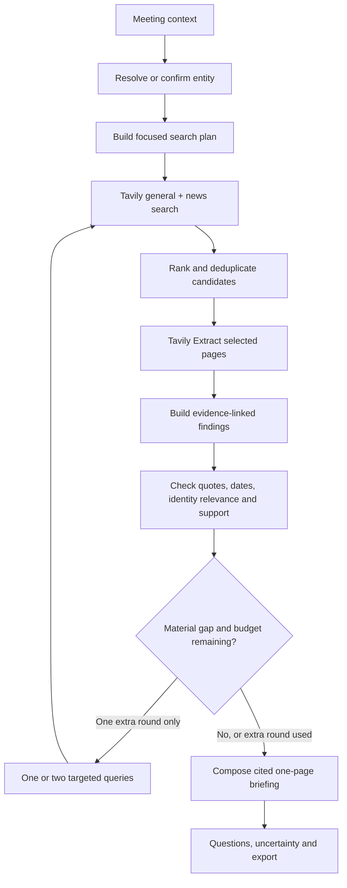

# Technology decisions — MeetingIntel

Decision date: 14 November 2026. This document selects the next implementation direction. Sections marked planned are not shipped functionality. Existing demo and Docker validation remain recorded in validation.md.

### Implementation follow-up

The original design below is retained as a decision record. The following parts are now implemented: structured meeting context; explicit user identity confirmation with lexical screening; mixed general/news query plans; selected-page Extract with partial-failure fallback; separate estimated/explicit date provenance and quoted event dates; strict provider JSON Schema with configured compatibility mode; a single conditional research round; snapshot/stage persistence; and an extractive cited summary after evidence checks.

Deliberate first-version limits: identity resolution is a user-confirmed hint, not automatic candidate discovery; findings remain verbatim quotations instead of model paraphrases; no separate semantic verifier or independence/contradiction detector is installed; no `updated_at` inference is made from provider estimates; stage records store timestamps, not a full distributed trace. Final composition is deterministic, so only two LLM synthesis stages are needed. The compact report caps output at four findings and one displayed reference per finding. Human/live quality evaluation and model choice still require keys. See architecture.md and validation.md for current behavior and actual checks.

## Product target

MeetingIntel takes a company or person and a scheduled meeting time. It produces a one-page briefing covering meaningful developments in the preceding 30 days, with sources and discussion questions.

Our primary demonstration scenario will be a **B2B technology partnership meeting**. Keep company/person inputs and the other meeting-purpose options. The specialization is contextual research: who the user represents, what they offer, and what outcome they want. Do not assume that every user is a seller or that every update represents a business opportunity.

## Stack selection

| Concern | Decision | Current status / next action |
|---|---|---|
| UI | Next.js + React + TypeScript + Tailwind, existing versions and lockfile | Keep tested build; add structured meeting context and entity confirmation |
| HTTP API | FastAPI + Pydantic v2 | Keep; extend evidence and context contracts |
| Workflow | LangGraph StateGraph | Keep; add conditional routing and at most one gap-research round |
| Retrieval | Tavily Search, both general and news queries | Existing adapter uses news only; add query-specific topic/domain settings |
| Page evidence | Tavily Extract | Planned; batch only selected URLs, inspect partial failures |
| External HTTP | HTTPX | Keep; use the same timeout/retry/budget boundary for Search, Extract and LLM calls |
| Model | One provider/model with native strict JSON Schema output | Existing compatible adapter uses JSON mode; add explicit provider capability configuration |
| Initial model candidate | Existing configurable gpt-4.1-mini | Candidate for the first live evaluation, not a measured winner or a requirement; confirm access before use |
| Persistence | SQLite | Store jobs in one local API process and introduce normalized source, evidence and trace records through migrations |
| Quality checks | Pytest + Vitest + Playwright + a versioned research evaluation set | Existing engineering tests pass; add evaluations of relevance, identity and evidence support |
| Progress | Existing polling and SSE endpoint | Polling is adequate; use fetch-based SSE when improving the progress experience |
| Export | Existing print CSS + browser Save as PDF + Markdown | Keep; add maximum-length print tests and a report content budget |
| Packaging | Existing Docker Compose + locked dependencies + GitHub Actions | Docker works locally; remote workflow still needs a GitHub run |

No core-framework migration or package-version sweep is needed for this architecture decision. Install dependencies when a concrete feature uses them, and refresh lockfiles with cross-platform validation.

## 1. Retrieval that answers the meeting question — planned

Replace three generic strings with typed search plans. A query has a purpose, topic, allowed/preferred domains, date bounds and result limit. Treat entity names/context as data.

First establish the entity's canonical name, website and role/employer when relevant. Ask the user to confirm an ambiguous match; an official-looking domain or a model score alone is not identity proof. Background pages may help resolve identity but must not become recent-event evidence without dates.

Use `general` queries for official newsroom/product/partner pages and `news` queries for coverage of launches, leadership and other developments. Request `include_published_date` and `include_usage` explicitly. Use domain restriction only on the official-source branch; keep a separate external-coverage branch. Preserve unknown dates separately rather than silently discarding all background.

Candidate selection considers entity match, meeting relevance, date evidence, source type, novelty and independent coverage. Tavily relevance scores are retrieval signals, not truth/confidence scores. Do not count syndicated copies as independent confirmations.

Start with three initial search requests, up to five results each, and at most two additional queries in a single gap round. These are application budgets, not Tavily API limits.

[Tavily Search reference](https://docs.tavily.com/documentation/api-reference/endpoint/search)

## 2. Selected-page extraction — planned

Use Tavily Extract on up to five selected public source URLs in one batch, rather than adding a browser scraper or a second search provider. Obtain article content before selecting evidence whenever possible. Apply input-text limits even when the provider returns long pages.

An HTTP 200 is not an all-URLs-success signal: reconcile `results` and `failed_results` by canonical URL, not list position. If extraction fails, preserve the search excerpt with an explicit `content_origin=search_snippet` label; never label it as a full article. If an extracted page and snippet differ, preserve both snapshots and their timestamps.

Store a SHA-256 digest and retrieval time for each snapshot so an evidence quote can be traced to the exact material used. A digest supports provenance; it does not certify authenticity or truth. Only send selected public URLs to the provider; exclude local/private addresses and credential-bearing URLs. Do not add direct server-side arbitrary URL fetching.

[Tavily Extract reference](https://docs.tavily.com/documentation/api-reference/endpoint/extract)

## 3. Date provenance — planned, essential

Tavily documents `published_date` as a best estimate of publication **or last update**, currently a beta feature. Our existing inclusion check validates a supplied timestamp's range; it does not independently establish an original publication date. Existing report date labels must therefore be improved before claiming verified publication dates.

Represent these separately:
- `provider_date`: estimated timestamp returned by retrieval provider.
- `published_at`: original publication date, if supported by explicit evidence.
- `updated_at`: explicit update date, if available.
- `occurred_at`: event date, if stated; publication date is not event date.
- `retrieved_at`: when this application obtained the material.
- `date_origin` and `date_precision`: provider estimate / explicit page evidence / unknown, plus day vs instant.

Keep the meeting-relative 30-day window capped at generation time. An old event in a recently updated page must not be described as a new event. A future product launch is a scheduled announcement, not a completed launch. If temporal support cannot be established, put the item in background/open questions instead of the recent-facts section.

Preserve the existing conservative handling of day-only boundary dates until a clearly documented alternative is tested. No model-invented timestamps and no arbitrary confidence percentages.

[Tavily date field semantics](https://docs.tavily.com/documentation/api-reference/endpoint/search)

## 4. Structured outputs and evidence contracts — planned

Move from JSON-object mode to native strict JSON Schema output for a compatible provider/model. Pydantic validation remains mandatory. Handle refusal, truncation and invalid responses as explicit outcomes. For providers without strict output support, allow only an explicitly configured JSON-mode path with validation and bounded repair; report that capability accurately.

Do not assume a common `/chat/completions` endpoint guarantees identical schema support. Store provider capability in backend configuration and test the exact model. Avoid adding a second AI framework on top of LangGraph just to obtain typed responses.

Suggested domain objects:
- `MeetingContext`: user organization/role, offer, desired outcome, counterpart, meeting purpose.
- `EntityProfile`: canonical identity, domain, identity evidence and ambiguity state.
- `Evidence`: source ID, exact quote, content origin, snapshot digest and date evidence.
- `Finding`: concise claim, evidence IDs, category, temporal status and support assessment.
- `DiscussionPoint`: suggested implication/question with finding IDs; distinguish inference from source statements.
- `CoverageGap`: missing information and one bounded follow-up search proposal.

Use arrays of fixed-shape evidence objects for strict provider schemas, rather than unrestricted dictionaries keyed by arbitrary source IDs. Add an explicit mapping step to the public report contract. Test schema support without executing paid calls in ordinary CI.

Keep deterministic existence/date/quote checks. A model can additionally assess whether evidence supports a paraphrase, with supported/partial/unsupported/unclear labels and quoted reasons. That assessment is fallible and is not a truth verdict. Build the executive summary only from retained findings, with citations, after verification. Until this layer passes evaluation, keep the existing extractive factual presentation.

[Structured Outputs vs JSON mode](https://developers.openai.com/api/docs/guides/structured-outputs)

## 5. Bounded adaptive workflow — planned

Use LangGraph conditional edges with an explicit `research_round` counter. Missing evidence is allowed to remain missing: a failed follow-up becomes an open question, not an invitation to invent an answer.

Keep a single orchestrated workflow. No multiple autonomous agent framework, shell access, broad website crawling, or unlimited reflection loops. User identity confirmation can return a typed ambiguity response and start a fresh job with the selected identity; persistent human-in-the-loop checkpointing is not needed for the first version.

Initial budget target for implementation: 3 initial + at most 2 follow-up Search requests, up to 2 Extract batches, and at most 3 LLM stages (initial evidence synthesis, optional follow-up synthesis, final composition). Transient retries and schema repairs count toward explicit total call/token budgets. Keep the 120s total deadline initially; tune only using observed live runs. Do not promise these limits or any performance result before implementing and testing them.

[LangGraph Graph API](https://docs.langchain.com/oss/python/langgraph/graph-api)

## 6. Evaluation and observability — planned

Add a versioned, small offline set (about 12 cases): company, person, ambiguous identity, sparse news, old event/new article, missing date, product launch, hiring, duplicate syndication, conflicting accounts, prompt injection and provider failure. Separate fixture correctness from later live quality measurements.

Record engineering invariants: no dangling citations, every displayed evidence quote matches its saved snapshot, no out-of-window item masquerades as a recent event, bounded calls, and one-page print layout for worst-case permitted input. Human review assesses useful prioritization, coherent summary, correct identity and whether questions fit the meeting. Optional model grading is a supplementary signal, never ground truth.

Use existing Python logging plus SQLite stage traces first: stage duration, status, provider request ID, source counts, token usage and returned Tavily credits when available. Redact headers, keys and user/private context. Keep total token/credit budgets distinct from USD estimates. Price estimates are provider-specific and should be unavailable when configuration or usage is incomplete.

External tracing is an option if live testing identifies a debugging need. Local diagnosis uses application logs and SQLite stage records.

## Alternatives considered

| Option | Decision and reason |
|---|---|
| Nebius Token Factory | Potential alternative provider if credits/access and exact model capabilities fit. Do not assert structured-output support, quality or price for an untested model. Keep one primary provider initially. |
| Tavily hosted Research | Consider after comparing evidence controls, budget and latency. Our own Search/Extract graph offers explicit meeting-context and provenance handling; do not replace it without an evaluation. |
| Tavily Map/Crawl | Defer broad discovery. Selected Search + Extract is sufficient for a small meeting briefing; broad crawling can consume the task budget. |
| Vector database / embeddings | Defer. A handful of current documents fits a bounded context; no long-lived knowledge corpus currently needs semantic retrieval. |
| Neo4j | Defer. Evidence relationships fit typed IDs and SQLite tables. |
| Redis/Celery/Postgres | Defer until public multi-process deployment, durable workers or concurrency requires them. SQLite remains a prototype boundary, not a scalability claim. |
| CrewAI / another agent SDK | Defer. LangGraph already owns control flow. A second framework adds integration work without an identified requirement. |
| RAGAS / automatic LLM-as-judge platform | Optional later. Start with targeted invariants and human-scored cases; model grading has cost and measurement uncertainty. |
| Server PDF browser / new PDF library | Defer. Existing browser export works; enforce a short report and test page count before adding another renderer. |
| New UI component framework | Defer. Improve the existing interface's evidence and context interactions rather than restyle working controls. |

## Implementation order and acceptance

1. **Context, identity and date contracts.** Add user role/offer/outcome, explicit identity state, source date provenance and migrations. Preserve old reports. Accept when ambiguous names require confirmation and provider estimates are labeled as estimates.
2. **Search + Extract.** Typed general/news query plans, selected-page extraction, partial failure handling and usage counting. Accept when official pages and external coverage are both reachable in mocked integration tests and snippet fallback is accurately labeled.
3. **Structured synthesis and adaptive routing.** Native schema capability, evidence-linked findings/questions and a single gap round. Accept when invalid output/refusal/truncation is handled, missing support is excluded and budgets hold.
4. **Briefing composition and quality evaluation.** Cited summary, ranked 3–5 findings, purpose-specific discussion points, explicit unknowns and print budget. Accept when offline cases and maximum-length print checks pass, then human review of real company/person outputs passes.
5. **Live integration validation.** Configure provider credentials locally, check actual company and person reports against their citations, and record observed latency and usage.

The first live provider smoke test should happen as soon as keys become available, before finishing advanced features. It validates credentials, model access, actual date formats and selected request options. Passing offline tests alone does not complete this work.
